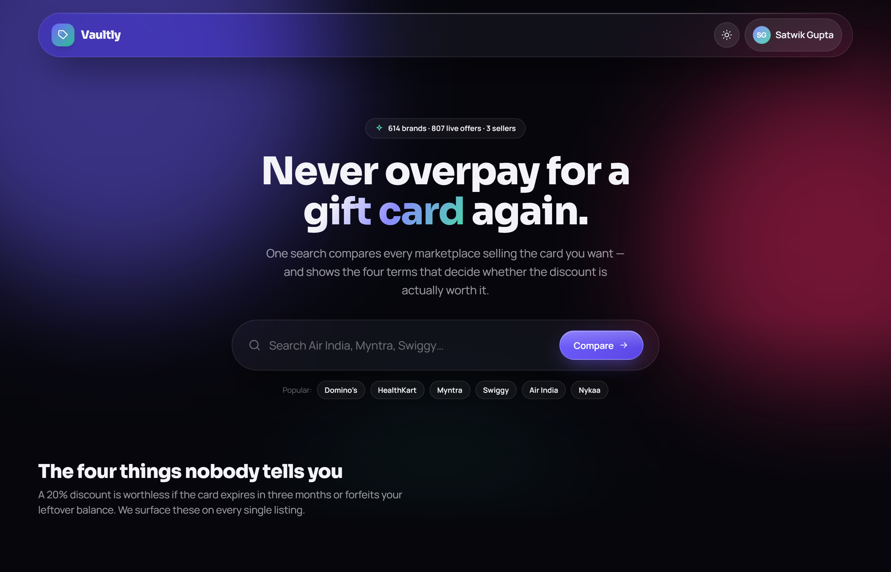
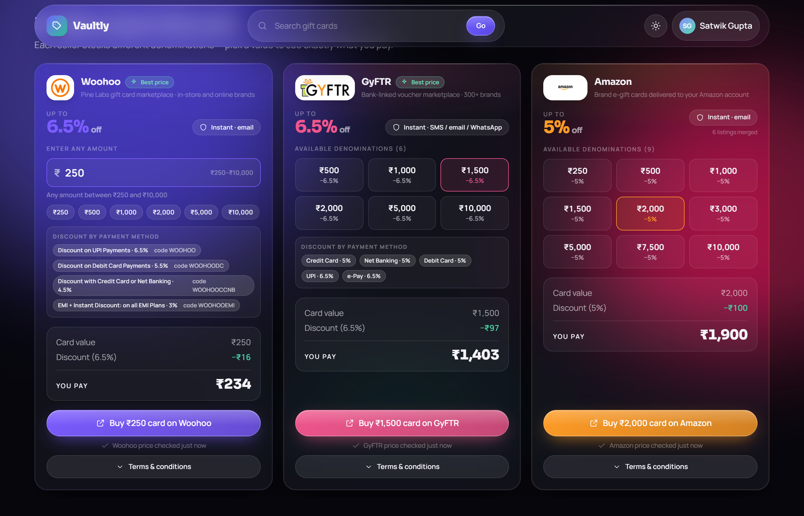

<div align="center">


### Never overpay for a gift card again.

One search compares every marketplace selling the card you want — and shows the four terms
that decide whether the discount is actually worth it.

<p>
  
  
  
  
  
</p>



</div>

---

## The problem

A 20% discount is worthless if the card expires in three months, can't be combined with a sale,
or forfeits whatever you don't spend. Marketplaces bury that in a wall of fine print — and they
all word it differently, so you can't compare them side by side.

Vaultly scrapes the sellers' own terms and puts the answers **in the same four rows for every
seller**, right next to the price.

<div align="center">
  
  <em>Every seller that stocks the card, with its real payable price, payment-method discounts and its own freshness stamp.</em>
</div>

---

## What it does

| | |
| --- | --- |
| 🔍 **Compares every seller** | GyFTR, Woohoo and Amazon.in, merged per brand. 614 brands, 807 live offers. |
| 📊 **Four facts, aligned** | Multiple cards per order · clubbing with offers · validity · leftover balance — same order, every panel, via CSS subgrid. |
| 💸 **Real payable price** | Pick a denomination and see face value → discount → what you actually pay. |
| 🏷️ **Payment-method offers** | Woohoo's Air India card shows 0% on paper but pays **6% via UPI** — surfaced with the coupon code. |
| 💰 **Cashback on top** | CashKaro's full rate table, whether it works on app or only web, and whether it stacks with a gift card at all. |
| ♻️ **Self-correcting catalog** | Opening the site syncs which cards still exist; opening a brand re-reads its live prices. |
| 🌓 **Dark / light** | Diagonal view-transition wipe, full keyboard and mobile support. |

---

## The four things nobody tells you

<div align="center">
  
</div>

Each answer keeps **the seller's own sentence it was derived from**, shown as a quote. If a seller
doesn't state something, it reads *"Not stated"* — never a plausible-looking guess.

---

## Cashback, honestly

<div align="center">
  
</div>

The headline rate always covers one slice of a catalogue, so it's shown as **"up to"** with every
published rate one tap away. More importantly: **19 of the 32 brands paying cashback exclude
gift-voucher payments**, so on those you pick one saving, not both. Vaultly says so, quoting the
clause.

---

## Quick start

```bash
npm install
npm run scrape     # fetch live prices -> public/catalog.json  (~6 min)
npm run dev        # http://localhost:5173
```

In a hurry? `npm run scrape:fast` skips the browser-driven Amazon source (~2 min).

```bash
npm run build      # production build into dist/
npm run preview    # serve the built output
```

**Optional backfills**

```bash
npm run fill:cashkaro   # cashback for every brand   (~2 min)
npm run fill:amazon     # Amazon listings by brand name (~1 hr)
```

---

## Deploying

The site deploys to **Vercel** straight from this repository — no server to run.

1. Sign in at [vercel.com](https://vercel.com) with GitHub.
2. **Add New → Project**, import this repository, and press **Deploy**. Nothing to configure —
   `vercel.json` sets the build, the page routing and the API functions.

Every push to `main` redeploys.

What runs where once deployed:

| Feature | Deployed site |
| --- | --- |
| Browsing, search, compare, themes, accounts, saved cards | ✅ Static |
| **Re-check prices now** — GyFTR, Woohoo, CashKaro | ✅ Live, via `api/refresh/[brandId].mjs` (~1–2 s) |
| Re-check — Amazon | 🕒 Daily. Needs a real browser, too heavy for a function; the panel shows its age |
| New and delisted cards | 🕒 Daily, via the scheduled scrape |

**The daily scrape** is `.github/workflows/refresh-prices.yml`. At 06:00 IST it scrapes every
seller (Amazon included), refreshes cashback, commits `catalog.json` and so triggers a redeploy.
Run it any time from the repository's **Actions → Refresh prices → Run workflow**. A blocked
Amazon run keeps yesterday's Amazon prices rather than wiping them.

A live re-check returns fresh prices to whoever pressed it but doesn't save them — serverless
filesystems are read-only. The shared catalog moves forward once a day.

---

## Where the data comes from

There is **no hand-authored catalog**. Everything is read from the sellers' own pages.

| Source | How it's read | Status |
| --- | --- | --- |
| **GyFTR** | `__NEXT_DATA__` Redux blob — discount, denominations, real T&C text, per-payment-method rates. Brands from `sitemap.xml`. | ✅ Full |
| **Woohoo** | `window.__INITIAL_STATE` → `appReducer.product`. Discount from `offerShortDesc`, payment offers from `campaigns`. Brands from `sitemap.xml`. | ✅ Full |
| **Amazon.in** | Real browser via Playwright — plain HTTP gets a bot check. Targeted search by brand name. | ⚠️ Rate-limited |
| **CashKaro** | `__NEXT_DATA__` → full rate table, app/web eligibility, gift-voucher exclusions. | ✅ Full |
| Paytm | App-only. `paytm.com/gift-cards` redirects to the homepage and the old catalog API returns `total_count: 0` for every query. Reading it would mean defeating certificate pinning on their app, which this project does not do. | ❌ Not possible |

---

## How freshness works

Three layers, each doing only what it's cheap enough to do:

| Layer | Covers | Cost | Trigger |
| --- | --- | --- | --- |
| **Catalog sync** | Which cards *exist* — adds newly listed, removes delisted | One sitemap per seller | Opening the site |
| **Live re-check** | One brand's prices, across **every** seller + cashback | ~8 s, ~25 s with Amazon | Opening a brand page, or the button |
| **Full scrape** | Everything | ~6 min | Manual or scheduled |

The sync deliberately **doesn't** check prices — re-reading 700 product pages on every page view
would be slow and pointless. And the re-check searches sellers that *aren't* currently listed, so a
card a seller has just started stocking shows up on its own.

Every panel stamps its own age. If one seller can't be reached, only that panel is marked stale —
the others still read *"checked just now"*.

<details>
<summary><b>Guard rails that stop a bad run destroying good data</b></summary>

<br>

- **Delisting needs proof.** A seller is only dropped when its page returns a hard 404/410. A live
  page with an empty product list is marked *sold out* instead — GyFTR leaves delisted pages up
  and serving HTTP 200, and deleting on that once wiped a brand that came back an hour later.
- **A broken sitemap removes nothing.** If more than 25% of a seller's listings vanish at once,
  that's treated as a broken sitemap, not a closed shop.
- **Blocked ≠ gone.** A CAPTCHA, timeout or network blip never counts as evidence of a delisting.
- **One writer at a time.** Both the sync and the re-check used to read `catalog.json`, spend 30 s
  on the network, then write their stale copy back — whichever finished last silently reverted the
  other. All writes now go through a lock in `server/catalog-store.mjs`.
- **The scrape won't shrink your catalog.** A half-failed run can't overwrite a healthy
  `catalog.json`; the guard is per seller, because healthy sellers hide one seller's collapse.

</details>

<details>
<summary><b>Scraper gotchas worth knowing</b></summary>

<br>

- **Woohoo's page `<title>` is not a usable discount source.** Their SEO copy goes stale — the
  Amazon Pay card's title claims "Flat 50% Off" while the product gives 0.5%.
- **Open-value cards** are `price.type === "RANGE"` and become a validated amount field, not fake
  min/max slabs.
- **Amazon lists one brand under many ASINs** with different denomination sets; they're merged,
  unioning denominations.
- **Amazon denominations must match on the ₹ sign.** A bare-number selector reads the artwork
  twister and reports 3 denominations where there are 9.
- **Category rules are `\b`-anchored.** Without word boundaries "blockbuster" matched `bus` and
  filed Zee5 under Travel.
- **Subscription plans fold into the parent brand.** Woohoo lists Zee5 as nine products; they
  appear as labelled packs in one section. The suffix must *start* with a plan token, or "Amazon
  Fresh" would collapse into "Amazon".
- **Brand matching is deliberately strict.** An Amazon search for "The Body Shop" also returns
  Bath & Bodyworks and Health and Glow — a loose match would staple a rival's price to the wrong
  brand.

</details>

<details>
<summary><b>Getting past Amazon's bot detection</b></summary>

<br>

1. **Don't spoof the user agent.** A UA claiming a different Chrome build than the real one is a
   fingerprint mismatch — Amazon responds by starting a bogus file download instead of rendering.
2. **Visit the homepage first.** Jumping straight to a search URL with no session cookies fails.
3. **Go slowly.** One page at a time, 600 ms apart, capped at 6 pages per brand.

Amazon still serves a CAPTCHA or a *"Click to continue shopping"* interstitial under load. Those
are detected and reported as **blocked** — never mistaken for a delisting, and never clicked
through. When it happens the panel keeps its previous numbers and says so.

</details>

---

## Project layout

```
src/
  components/      SitePanel · KeyFactsCompare · CashKaroCard · TermsSection
  pages/           Home · SearchResults · BrandCompare
  services/        catalog.ts — the only module components read data from
  types.ts         domain model + fixed order of the four key facts
server/
  catalog-store.mjs  the single writer for catalog.json (locked, atomic)
  refresh.mjs        re-reads one brand from every seller      GET /api/refresh/:brandId
  discover.mjs       adds newly listed / removes delisted      GET /api/discover
scripts/
  scrape.mjs       CLI orchestrator
  sources/*.mjs    one adapter per seller — add a file to add a seller
  lib/facts.mjs    the four-key-fact derivation rules
  lib/build.mjs    classification, folding, merging
```

The two API routes are Vite middleware, so there's no second process to start — they work under
both `npm run dev` and `npm run preview`. On a statically hosted `dist/` they simply fail silently
and the site serves the last scraped catalog.

---

## Adding a seller

Create `scripts/sources/<name>.mjs` exporting `PLATFORM`, `listBrandUrls()` and
`fetchBrand({ slug, url })` returning `{ key, name, logo, offer }`, then register it in the
`SOURCES` map. Brands merge across sellers on `brandKey(name)`, which strips apostrophes and
gift-card boilerplate so `DOMINO'S` and `Domino's E-Gift Voucher` collapse together.

---

<div align="center">
<sub>Prices and terms are scraped from public seller pages and can change at any time.<br>
Always confirm on the seller's own page before buying — every panel links straight to it.</sub>
</div>
